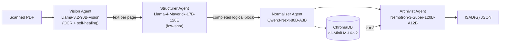

# A Multi-Agent Architecture for Processing and ISAD(G) Cataloging of Documentary Heritage

**Gabriel Lima Nunes** — Department of Computer Science (DCC), Universidade Federal de Minas Gerais (UFMG)

📄 [Paper (PDF)](paper/paper.pdf) · [LaTeX source](paper/main.tex)

This repository holds the code, the evaluation data and the generated artifacts for the paper
*"A Multi-Agent Architecture for Processing and ISAD(G) Cataloging of Documentary Heritage"*.
Every number in the paper's tables can be reproduced with the scripts in
[`evaluation/`](evaluation/) and the results stored in [`results/`](results/).

---

## Abstract

Preserving and cataloging historical documentary heritage is hard because traditional OCR
struggles with complex layouts. On top of that, normalizing archaic Portuguese and mapping the
data onto archival standards such as ISAD(G) takes a lot of manual work and becomes an
operational bottleneck. We propose an autonomous multi-agent architecture built on LLMs and
VLMs. It orchestrates four specialized agents: **visual extraction**, **semantic routing**,
**intralingual normalization** and **RAG-enhanced archival cataloging**. We validated it on
**917 pages** of the *Annaes da Escola de Minas de Ouro Preto* (1881–1885). The pipeline
reached word-level transcription accuracy between **95.22% and 99.27%**, modernized the
spelling of most of the corpus without changing its length, and generated coherent ISAD(G)
metadata.

## Architecture



| Agent | Model (NVIDIA NIM) | Role |
|---|---|---|
| Vision | `meta/llama-3.2-90b-vision-instruct` | Transcribes pages (200 dpi, 5 workers) and replaces tables and images with `[TABELA: …]` / `[IMAGEM: …]` tags. Saves an incremental checkpoint and re-runs pages shorter than 10 characters. |
| Structurer | `meta/llama-4-maverick-17b-128e-instruct` | Decides, page by page, whether a new logical division starts. Returns `{contem_novo_artigo, titulo_artigo, autor}`. |
| Normalizer | `qwen/qwen3-next-80b-a3b-instruct` | Modernizes archaic Portuguese spelling without summarizing or omitting text. |
| Archivist | `nvidia/nemotron-3-super-120b-a12b` | Fills in the ISAD(G) schema using RAG context (500-character chunks, 50-character overlap, k = 3). |

Two resilience mechanisms keep runs stable:
- `invoke_with_retry` retries failed calls up to 5 times, 3 s apart.
- The start and end pages and the `BR MG-EMOP …` reference code are set by Python code in the
  final JSON instead of being generated by the model.

> The prompts and the JSON schema requested from the models are in Portuguese, because the
> corpus is in 19th-century Portuguese. They are the exact prompts used in the paper.

## Repository structure

```
.
├── paper/
│   ├── paper.pdf                          # Paper
│   └── main.tex                           # LaTeX source
├── src/
│   └── pipeline_annaes.py                 # Full multi-agent pipeline
├── evaluation/
│   ├── evaluate_transcription.py          # Word-level OCR accuracy      (Sec. VI-A)
│   ├── evaluate_segmentation.py           # Precision / Recall / F1      (Table I)
│   ├── analyze_normalization.py           # Token parity and lexicon     (Table III)
│   ├── normalization_stats.py             # Token mean ± std             (Sec. VI-C)
│   └── analyze_latency.py                 # Per-agent latency            (Table IV)
├── data/
│   ├── editions/                          # Annaes PDFs (not versioned, see README)
│   ├── segmentation_ground_truth/         # Section-boundary ground truth (1881–1885)
│   └── transcription_ground_truth/        # Manually transcribed control sections
└── results/
    ├── transcription_checkpoints/         # Vision Agent output (one JSON per edition)
    ├── raw_texts/                         # Raw text of each logical division
    ├── normalized_texts/                  # Text after intralingual normalization
    ├── isadg_records/                     # Generated ISAD(G) records (JSON)
    ├── logs/                              # Run logs with latencies
    └── metrics/                           # Evaluation script outputs + manual audit
```

## Dataset

The *Annaes da Escola de Minas de Ouro Preto* come from the Brazilian Digital Newspaper Library
(Hemeroteca Digital Brasileira, National Library Foundation, BNDigital):

| Edition | File | Pages |
|---|---|---:|
| 1881 | `per717703_1881_00001.pdf` | 182 |
| 1883 | `per717703_1883_00002.pdf` | 164 |
| 1884 | `per717703_1884_00003.pdf` | 240 |
| 1885 | `per717703_1885_00004.pdf` | 331 |
| **Total** | | **917** |

The PDFs are not versioned because of their size. See
[`data/editions/README.md`](data/editions/README.md) for how to get them. Each segmentation
ground-truth file (`data/segmentation_ground_truth/<year>.txt`) lists one division per line in
the format `start_page, TITLE`.

## Results

### Visual transcription (OCR)

We audited three control sections from the 1881 edition, 832 tokens in total. The model made
no insertions and a single deletion.

| Control section | Words | Accuracy |
|---|---:|---:|
| A Assembléa Legislativa da provincia de Minas Geraes… | 356 | 95.22% |
| Untitled division | 201 | 97.01% |
| Noticia sobre a Escola de Minas de Ouro Preto | 275 | 99.27% |

### Semantic segmentation (Table I)

| Edition | TP | FP | FN | Precision | Recall | F1 |
|---|---:|---:|---:|---:|---:|---:|
| 1881 | 15 | 38 | 0 | 0.28 | 1.00 | 0.4412 |
| 1883 | 13 | 19 | 1 | 0.41 | 0.93 | 0.5652 |
| 1884 | 13 | 49 | 1 | 0.21 | 0.93 | 0.3421 |
| 1885 | 41 | 116 | 4 | 0.26 | 0.91 | 0.4059 |

We manually categorized the 38 false positives of 1881
([`false_positive_audit_1881.txt`](results/metrics/false_positive_audit_1881.txt)):

| Category | Count |
|---|---:|
| Subsection | 17 |
| Chemical analyses | 10 |
| Numerical tables | 5 |
| Images/annexes | 4 |
| Arbitrary splits | 2 |

### Intralingual normalization

| Group | Documents | Input tokens | Output tokens |
|---|---:|---:|---:|
| Structure preserved | 211 | 378.41 ± 431.74 | 381.14 ± 445.84 |
| Omission / truncation | 34 | 3074.56 ± 2195.31 | 1738.00 ± 881.42 |

The failures are concentrated in long documents, where the output reaches the
`max_completion_tokens = 4096` limit.

### Latency (Table IV)

| Agent / Task | Calls | Mean (s) | Std. dev. (s) |
|---|---:|---:|---:|
| Vision (OCR) | 883 | 61.83 | ± 32.74 |
| Structurer | 945 | 1.28 | ± 2.66 |
| Normalization | 339 | 14.75 | ± 16.27 |
| ISAD(G) (RAG) | 336 | 19.84 | ± 24.08 |

### Sample ISAD(G) record

The record content is in Portuguese, the language of the collection:

```json
{
    "area_identificacao": {
        "codigo_referencia": "BR MG-EMOP per717703_1881_00001_ESTUDO_GEOLOGICO_DAS_JAZIDAS_DE_TOPAZIOS_DA_PROVIN",
        "titulo": "Estudo geológico das jazidas de topázios da província de Minas Gerais",
        "data": "Não identificado"
    },
    "area_contextualizacao": { "nome_produtor": "Não identificado" },
    "area_conteudo_estrutura": {
        "ambito_e_conteudo": "O documento descreve a localização geológica das jazidas de topázio e euclásio na província de Minas Gerais, ..."
    },
    "area_pontos_acesso": {
        "pessoas": ["Claussen"],
        "lugares": ["Ouro Preto", "Serra da Cachoeira", "Maciço do Itacolumy", "Rio das Velhas", "..."]
    },
    "pagina_inicio": 20,
    "pagina_fim": 24
}
```

The keys map to the ISAD(G) areas: identity statement (`area_identificacao`), context
(`area_contextualizacao`), content and structure (`area_conteudo_estrutura`) and access points
(`area_pontos_acesso`, with persons and places).

## Reproduction

### 1. Environment

```bash
python -m venv .venv && source .venv/bin/activate
pip install -r requirements.txt
cp .env.example .env    # fill in NVIDIA_API_KEY
export $(grep -v '^#' .env | xargs)
```

### 2. Reproduce the paper's metrics (no API calls)

The evaluation scripts use only the Python standard library. They read the artifacts already
stored in `results/`:

```bash
python evaluation/evaluate_transcription.py   # OCR accuracy
python evaluation/evaluate_segmentation.py    # Table I
python evaluation/analyze_normalization.py    # Table III; writes results/metrics/normalization_tokens.csv
python evaluation/normalization_stats.py      # token means from Sec. VI-C
python evaluation/analyze_latency.py          # Table IV
```

Reference outputs for each script are in [`results/metrics/`](results/metrics/).

### 3. Run the full pipeline

With the PDFs in `data/editions/`:

```bash
python src/pipeline_annaes.py
```

The pipeline writes its outputs to `results/`. If a checkpoint already exists in
`results/transcription_checkpoints/`, the pipeline reuses the OCR output and only re-processes
empty pages. To transcribe an edition from scratch, delete its checkpoint. The models are
generative, so new runs may give different results from the published ones.

## Limitations

- **Over-segmentation:** the Structurer mistakes subsections, chemical analyses and tables for
  new chapters. This gives high recall but low precision.
- **Truncated normalization:** on long documents, the model sometimes summarizes the text
  despite being told not to.
- **Access points:** person-name extraction is non-deterministic, and institutions are
  sometimes listed as places.
- **Indirect prompt injection:** the PDFs are not sanitized, so malicious text inside a document
  could steer the Archivist Agent.

## Citation

```bibtex
@article{nunes2026multiagent,
  title  = {A Multi-Agent Architecture for Processing and {ISAD(G)} Cataloging of Documentary Heritage},
  author = {Nunes, Gabriel Lima},
  year   = {2026},
  note   = {Department of Computer Science, Universidade Federal de Minas Gerais}
}
```
